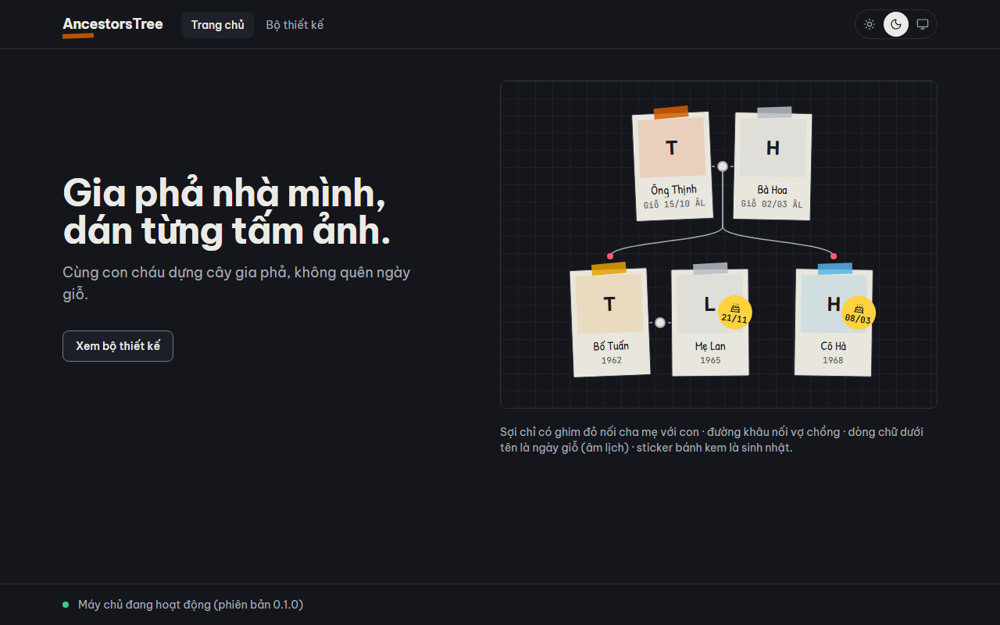
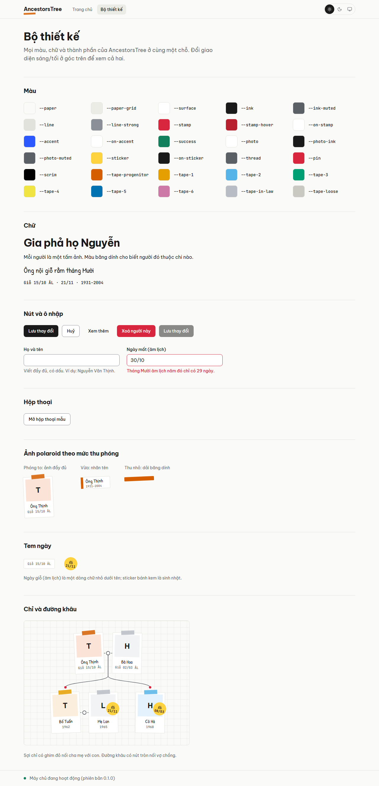
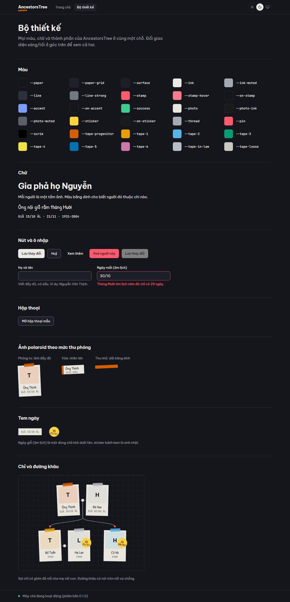
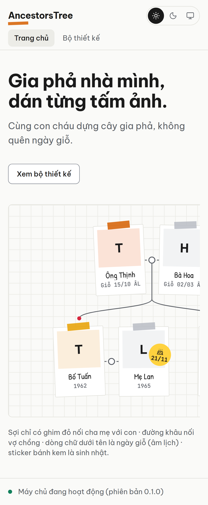

# Design system

## 1. Overview

AncestorsTree looks like a family scrapbook laid out on grid paper. Each person is a polaroid with a handwritten caption, and every decoration carries data: the washi tape color shows the person's branch, a thread ending in a red pin joins a parent to a child, a dashed stitch with a round knot marks a marriage, a quiet line under the caption shows a death anniversary and a round yellow sticker with a cake shows a birthday. The direction is aimed at the younger family members who enter most of the data, while staying readable for older relatives. The rules and the token values come from [spec §13.3](superpowers/specs/2026-11-11-ancestors-tree-design.md#133-visual-direction-family-scrapbook-anti-slop). The reasons behind the direction and the hand-written components are in [ADR 0004](adr/0004-scrapbook-design-system.md). Every token and component is shown in both themes on the live `/design` page of the app (`http://localhost:5173/design` when running `pnpm dev`, or `/design` on any Netlify deploy).

## 2. Where things live

All paths are relative to `apps/web/src/`.

| Path                    | Contents                                                                                        |
| ----------------------- | ----------------------------------------------------------------------------------------------- |
| `shared/ui/tokens.css`  | tokens: colors (light and dark), fonts, radii, the lift shadow, durations, easing               |
| `styles/index.css`      | base layer (focus outline, heading style), utilities (`board-grid`, animations), reduced motion |
| `styles/fonts.ts`       | fonts: the Fontsource imports with their weights                                                |
| `shared/ui/*`           | components: `Button`, `TextField`, `Dialog`, the contrast helper                                |
| `shared/ui/scrapbook/*` | scrapbook primitives: `Polaroid`, `DateMark`, `Thread`, `Stitch`, `Board` and their geometry    |
| `shared/ui/theme/*`     | theme: preference storage, `ThemeProvider`, `ThemeToggle`                                       |

Features import all of these through `shared/ui/index.ts` only.

## 3. Tokens

### Colors

Light is "grid paper by day", dark is "desk at night". Polaroid paper stays light in both themes.

| Token                               | Light                                                                                                            | Dark               | Use                                          |
| ----------------------------------- | ---------------------------------------------------------------------------------------------------------------- | ------------------ | -------------------------------------------- |
| `paper` / `paper-grid`              | #FAFAF8 / #ECECE7                                                                                                | #14161C / #1E2129  | page and board background, 22 px grid        |
| `surface`                           | #FFFFFF                                                                                                          | #1C1F27            | panels, dialogs, inputs                      |
| `ink` / `ink-muted`                 | #1A1A1A / #5B5F66                                                                                                | #ECEAE4 / #A4A9B3  | text                                         |
| `line` / `line-strong`              | #E2E2DC / #8A8F98                                                                                                | #2C303A / #737882  | decorative borders / control borders (≥ 3:1) |
| `stamp` / `on-stamp`                | #D7263D / #FFFFFF                                                                                                | #FF5A6E / #14161C  | anniversaries, destructive actions           |
| `stamp-hover`                       | #B8202F                                                                                                          | #FF7A8B            | danger button hover (`on-stamp` ≥ 4.5:1)     |
| `accent` / `on-accent`              | #2B59FF / #FFFFFF                                                                                                | #7C9CFF / #14161C  | links, focus ring, selection                 |
| `success`                           | #12805C                                                                                                          | #3CCB91            | "server is running" and other OK states      |
| `thread` / `pin`                    | #5B5F66 / #D7263D                                                                                                | #A4A9B3 / #FF5A6E  | relationship lines                           |
| `photo`, `photo-ink`, `photo-muted` | #FFFFFF, #1A1A1A, #5B5F66                                                                                        | #E9E6DD, same inks | polaroid paper and what is printed on it     |
| `sticker` / `on-sticker`            | #FFD23F / #1A1A1A                                                                                                | same               | birthday stickers                            |
| `tape-*`                            | progenitor #D55E00; branches #E69F00, #56B4E9, #009E73, #F0E442, #0072B2, #CC79A7; in-law #B8BCC4; loose #C9C9C2 | same               | washi tape                                   |

One more token, `scrim` (#000000 in both themes), is the overlay behind dialogs and is always used with opacity (`bg-scrim/45`).

### Utilities each token produces

Every color token except the tapes is mapped in the `@theme inline` block of `tokens.css`, so Tailwind generates `bg-<token>`, `text-<token>`, `border-<token>`, `stroke-<token>` and `fill-<token>` for it (for example `bg-paper`, `text-ink-muted`, `border-line-strong`, `stroke-thread`, `fill-pin`), and the opacity modifiers such as `bg-ink/85`. The tapes are not utilities: components get them as `var(--tape-*)` through `tapeColor()`.

The `@theme` block also defines `font-ui`, `font-hand` and `font-mono`; `rounded-photo` (2 px), `rounded-control` (0.5 rem) and `rounded-pill`; `shadow-lift`; and `ease-settle`. Durations are used as `duration-(--duration-fast)`, `duration-(--duration-base)` and `duration-(--duration-settle)`.

Tailwind's default colors, fonts, radii and shadows are reset (`--color-*: initial` and so on), so a class such as `bg-red-500` or `shadow-md` does not exist. Raw hex values appear only in `tokens.css`.

### Adding a token

1. Define it in `:root` in `tokens.css` as a six-digit hex value.
2. If it changes with the theme, redefine it in the `:root[data-theme='dark']` block.
3. Map it in `@theme inline` as `--color-<name>: var(--<name>)`.
4. Add its contrast pairs to `TEXT_PAIRS` or `NON_TEXT_PAIRS` in `tokens.test.ts`; the test checks both themes.
5. Add it to the `COLOR_TOKENS` list of the `/design` gallery (`features/design-gallery/DesignGalleryPage.tsx`).

## 4. Typography

Only three families exist. All are self-hosted with Fontsource, including their Vietnamese subsets; each face uses `unicode-range`, so a page downloads only the subsets it needs.

| Family         | Utility             | Allowed for                                                                | Weights loaded |
| -------------- | ------------------- | -------------------------------------------------------------------------- | -------------- |
| Be Vietnam Pro | `font-ui` (default) | all UI text: body, labels, controls, headings                              | 400, 500, 700  |
| Patrick Hand   | `font-hand`         | only captions on photos and handwritten notes; never controls or body text | 400            |
| JetBrains Mono | `font-mono`         | dates, stamps, stickers, life years and other numbers                      | 500, 700       |

Headings (`h1` to `h3`) are Be Vietnam Pro 700 with −0.02em letter spacing and balanced wrapping, set in the base layer of `styles/index.css`. Weight 500 is for button text and field labels.

## 5. Components

### Button

| Variant     | Look                                                         | Use for                                                                          |
| ----------- | ------------------------------------------------------------ | -------------------------------------------------------------------------------- |
| `primary`   | ink background, paper text (the default)                     | the one main action of a view                                                    |
| `secondary` | surface background, `line-strong` border                     | other actions, and links styled as buttons                                       |
| `ghost`     | text only, grid tint on hover                                | low-emphasis actions such as "see more" and icon buttons                         |
| `danger`    | `stamp` background (`stamp-hover` on hover), `on-stamp` text | destructive actions only (deleting a person, leaving a clan); never for emphasis |

Sizes are `sm` (32 px high), `md` (40 px, the default) and `icon` (40 × 40 px, which needs an `aria-label`). A button is `type="button"` unless told otherwise. With `asChild` it styles its single child, for example a router `Link`. Disabled buttons are at half opacity and ignore pointer events.

### TextField

The label is always visible above the input and linked to it. An optional `hint` appears below in `ink-muted`. An `error` appears below the hint in `stamp`, turns the border `stamp` and sets `aria-invalid`. The input's `aria-describedby` lists the hint, then the error, so screen readers read both. Placeholders are never used as labels.

### Dialog

`DialogContent` always needs a `title`; it becomes the dialog's accessible name. A `description` is optional. The dialog sits on a `scrim` overlay, has a close button labelled from the locale files, closes with Escape and returns focus to the control that opened it (Radix).

## 6. Scrapbook primitives

### Polaroid

A polaroid has three levels of detail, chosen by the canvas zoom (spec §7.4).

| Level (`lod`) | Zoom       | Size (px) | Shows                                                                                                                                        |
| ------------- | ---------- | --------- | -------------------------------------------------------------------------------------------------------------------------------------------- |
| `full`        | above 0.8  | 100 × 138 | tape, photo (or initials on a block tinted with the tape color), handwritten caption, the date line under it, stickers on the photo's corner |
| `label`       | 0.4 to 0.8 | 100 × 40  | a taped name label with the life years                                                                                                       |
| `strip`       | below 0.4  | 100 × 14  | only a strip of washi tape in the branch color                                                                                               |

The sizes are exported as `POLAROID_SIZE`, so layout code and threads use the same numbers. Every level keeps the accessible name from `label`.

The **date line** under the caption shows `dateLine` (the death anniversary, a `DateMark`) or, when there is none, `lifeYears`, so every full card has the same height. `marks` (birthday stickers) sit on the photo's corner and never cover the caption.

### TapeKind

`TapeKind` is `'progenitor'`, `'in-law'`, `'loose'` or a number. A number is the index of the person's branch (the child of the progenitor the person descends from) and cycles through the six Okabe–Ito branch tapes; negative and fractional numbers are accepted. `tapeColor()` turns a `TapeKind` into `var(--tape-*)`.

### tiltFor

`tiltFor(id)` gives each card a small tilt between −2.5° and 2.5° (`MAX_TILT`) in 0.1° steps, from an FNV-1a hash of the person id. The board looks hand-made, but a card has the same angle on every render and device.

### DateMark

| Kind                | Look                                                                                   | Meaning                        |
| ------------------- | -------------------------------------------------------------------------------------- | ------------------------------ |
| `death-anniversary` | a quiet line under the caption: mono 11 px in `photo-muted`, no stamp, no tilt, no red | death anniversary (lunar date) |
| `birthday`          | round yellow sticker, 44 px, tilted 8°, a line-drawn Lucide `Cake` above the date      | birthday                       |

A death anniversary remembers someone who has died, so it is written quietly instead of stamped. Each mark shows a short text (`children`: "Giỗ 15/10 ÂL", "21/11") and gives screen readers the full one (`label`: "Ngày giỗ 15/10 âm lịch", "Sinh nhật 21/11"). The texts come from the locale keys `scrapbook.deathAnniversary`, `scrapbook.deathAnniversaryLabel` and `scrapbook.birthday`. The anniversary line uses photo-paper inks, so it is only placed on photo paper.

### Thread and Stitch

Both render inside the board's SVG layer and take board coordinates.

- `stitchEnds(a, b, size)` returns the facing edge points, at mid-height, of two cards given by their top-left corners, in either order. `Stitch` draws a dashed line between them with a round knot at the midpoint.
- `pinPoint(child, size)` is the red pin `PIN_OFFSET` (16 px) above the centre of the child's top edge.
- `Thread` starts at the couple's knot (or a single parent's bottom edge), runs straight down to `THREAD_DROP` (8 px) below the parents' cards and then curves to the child's pin.
- A selected thread or stitch is drawn thicker in `stamp`.

### Board

`Board` is the grid-paper surface (22 px squares, `board-grid` utility) that holds positioned polaroids and the SVG layer. It is a labelled group.

## 7. Theme and motion

The theme preference (`light`, `dark` or `system`) is stored in localStorage under `ancestors-tree:theme`; `system` is the default and follows `prefers-color-scheme`, including live changes. If storage is blocked, the choice lasts for the current page only.

`main.tsx` reads the preference and sets `data-theme` on `<html>` before React renders. It is a deferred module script, though, so the browser can paint the empty page before it runs. Until then, `tokens.css` follows `prefers-color-scheme` and paints a dark page background for users whose system is dark, which covers the default `system` choice. A user whose stored choice differs from the system setting may briefly see the system's background until the script runs.

CSS animations and transitions are switched off globally under `prefers-reduced-motion: reduce` (`styles/index.css`). Motion driven by JavaScript (fly-to and drag settle on the tree canvas) must check `useReducedMotion()`, which follows the media query and its changes.

| Token               | Value  | Use                                  |
| ------------------- | ------ | ------------------------------------ |
| `--duration-fast`   | 120 ms | hover and color changes              |
| `--duration-base`   | 200 ms | dialogs and overlays                 |
| `--duration-settle` | 380 ms | a card settling after a drag, fly-to |

Easing uses `ease-settle`. The lift shadow (`shadow-lift`) is reserved for a card while it is dragged; resting cards have no shadow.

## 8. Accessibility rules

- Every interactive element is reachable by keyboard and shows a 2 px `accent` outline with a 2 px offset on `:focus-visible` (base layer). The first Tab stop is the skip link to the main content.
- Text and its background reach at least 4.5:1 contrast, and borders, lines and the success dot at least 3:1, in both themes. `tokens.test.ts` checks every pair.
- Icons come only from `lucide-react`, with `strokeWidth={1.75}` and `aria-hidden="true"`. The accessible name always comes from the control (an `aria-label` on an icon button, or a visible label). No emoji.
- A polaroid's `label` is its accessible name: the person's name and life years, and on the tree also the generation (spec §7.8). The caption, initials and date marks are visual; a screen reader hears the label.
- When the sample board is wider than the screen, its scroll wrapper is a focusable region named by the locale key `home.boardScroll`, so keyboard users can scroll it with the arrow keys.
- All user-facing text comes from `locales/vi.json` and `locales/en.json`, and `<html lang>` follows the active language.

## 9. Anti-slop review (S9)

The review was run on the screenshots below and the code, against the checklist in spec §13.3. Two problems were found and fixed in the review: the date marks covered the end of the caption ("Ông Thịnh", "Bà Hoa"), so they now sit on the photo's corner; and the date-mark text was 9 to 10 px, now 11 px with a slightly larger sticker.

| Checklist item                                                                       | Result           | Evidence                                                                                                                                                                                                                                                                                  |
| ------------------------------------------------------------------------------------ | ---------------- | ----------------------------------------------------------------------------------------------------------------------------------------------------------------------------------------------------------------------------------------------------------------------------------------- |
| No purple/indigo gradients, no glassmorphism, no glowing blobs, no emoji as icons    | pass             | the only gradient in the code is the 22 px board grid (`styles/index.css`); no `backdrop-filter` or blur; screenshots show no emoji                                                                                                                                                       |
| No default shadcn look; tokens customized first; Tailwind's default palette removed  | pass             | `tokens.css` resets `--color-*`, `--font-*`, `--radius-*`, `--shadow-*`; unit test "maps every Tailwind color to a defined token"                                                                                                                                                         |
| No "hero + three feature cards" landing; the landing page shows a real (sample) tree | pass             | home screenshots: headline and one button beside the sample family board; `HomePage.test.tsx`                                                                                                                                                                                             |
| No identical gray cards everywhere; hierarchy from type, spacing and a few accents   | pass             | the `/design` screenshots: sections are separated by headings and hairlines, not cards; the only accents are tape, pins and stickers                                                                                                                                                      |
| No drop shadows on resting cards; depth only while lifted                            | pass             | `shadow-lift` is the only shadow token and no resting component uses it; polaroids have a 1 px `line` border                                                                                                                                                                              |
| No decoration without meaning                                                        | pass (after fix) | tape = branch, thread = parent/child, stitch = marriage, date line = death anniversary, cake sticker = birthday; "writes death anniversaries under the name and stickers birthdays with a cake", "sticks stickers on the photo, not over the caption", "keeps the date readable at 11 px" |
| Branch colors from the Okabe–Ito palette                                             | pass             | `--tape-*` in `tokens.css`; unit test "defines the washi tape palette"; `tape.test.ts`                                                                                                                                                                                                    |
| Light and dark themes both designed                                                  | pass             | light and dark screenshots; contrast tests run for both themes; e2e "remembers the chosen theme after a reload"                                                                                                                                                                           |
| Motion is purposeful and short; respects `prefers-reduced-motion`                    | pass             | only color transitions (120 ms) and the dialog fade/scale (200 ms); e2e "turns animations off when the user asks for reduced motion"; `useReducedMotion.test.ts`                                                                                                                          |
| Icons from one set (Lucide) at stroke width 1.75                                     | pass             | `Dialog.tsx`, `ThemeToggle.tsx` and `DateMark.tsx` are the only icon users, all with `strokeWidth={1.75}` and `aria-hidden`                                                                                                                                                               |

Home page, desktop, light theme:

Home page, desktop, dark theme:

Design gallery, desktop, light theme:

Design gallery, desktop, dark theme:

Home page, mobile, light theme:

